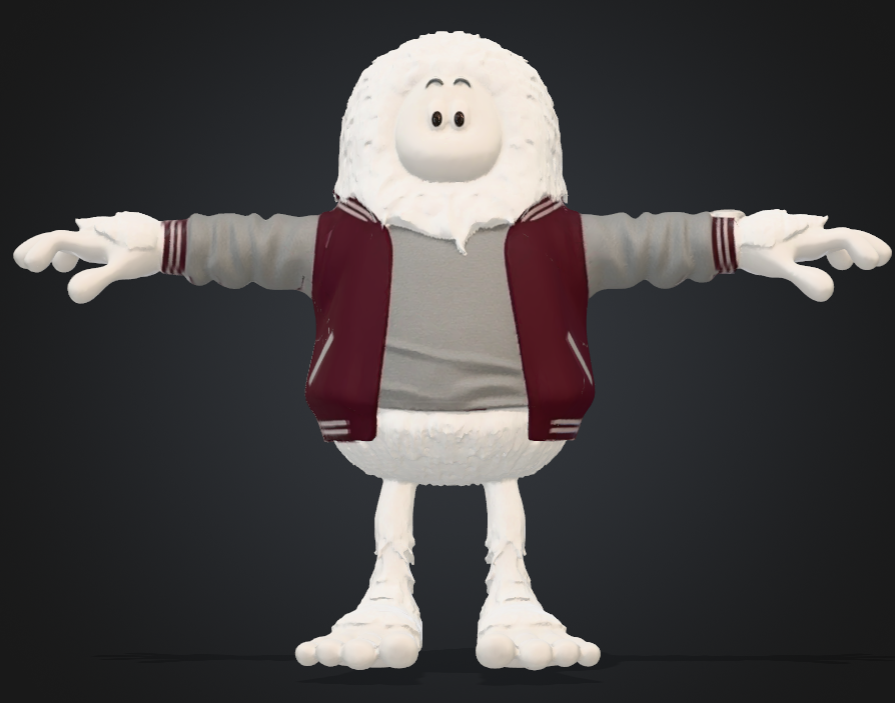
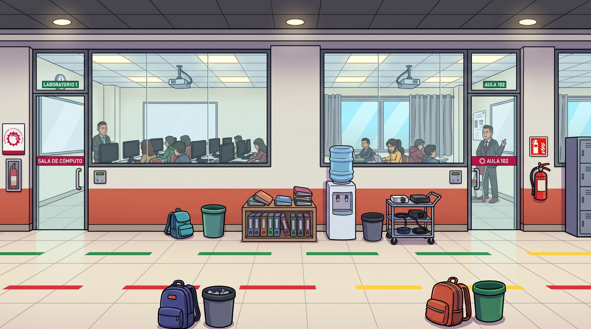
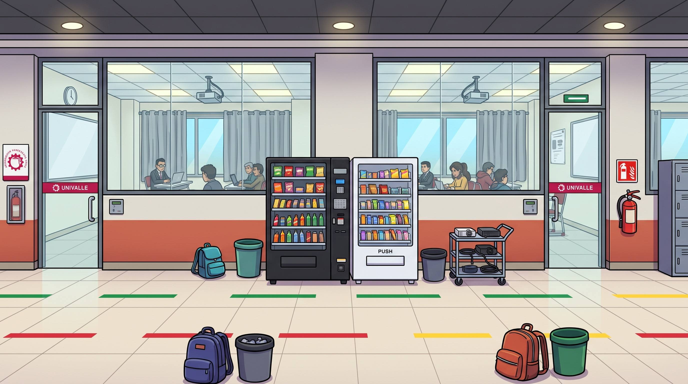
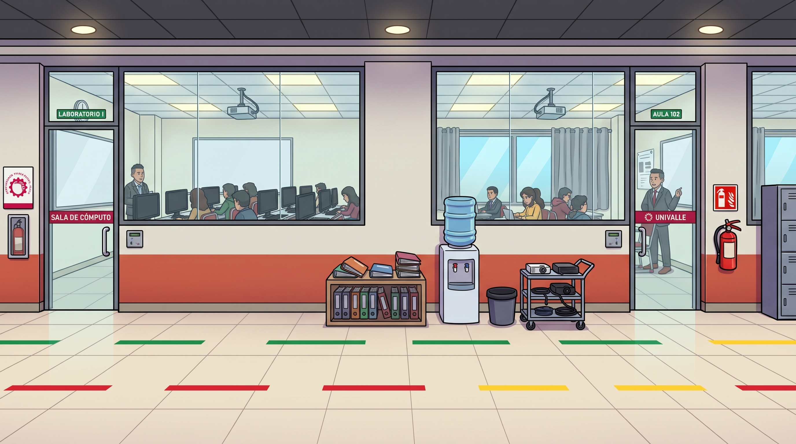
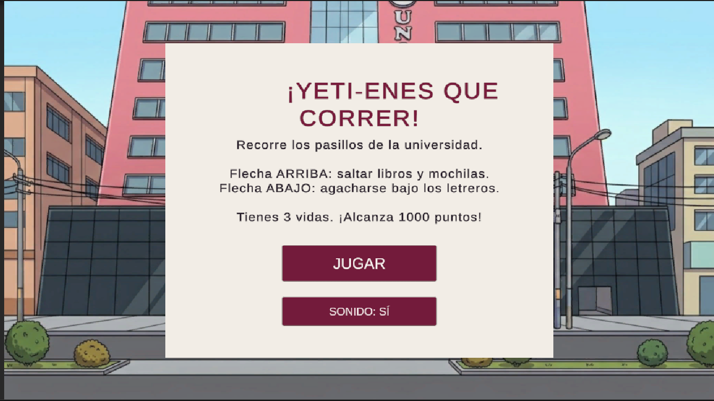
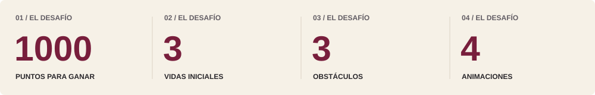

# 🏃‍♂️ Corre Yeti Corre

<!-- Cabecera / Banner -->

 

<!-- Badges de estado y tecnologías siguiendo la paleta guinda y blanca -->

 

<!-- Botones de Enlaces / Call to Action -->

  
  &nbsp;&nbsp;
  
  &nbsp;&nbsp;
  

---

  <b>Un Endless Runner frenético en Unity ambientado en los pasillos universitarios.</b> 
  Ayuda a nuestro Yeti universitario a esquivar mochilas, lockers, bebederos y conos de tráfico para llegar a tiempo a su defensa de proyecto.

---

## 📖 Historia

  
<i>¡Se hace tarde! El reloj avanza, la mochila está lista y cualquier obstáculo en el camino puede costarte la nota final.</i>

  <table>
    <tr>
      <td align="center" width="50%">
        
         
        <b>Acto 1: La Carrera Contra el Tiempo</b>
      </td>
      <td align="center" width="50%">
        
         
        <b>Acto 2: Obstáculos en el Campus</b>
      </td>
    </tr>
  </table>

---

## 🧊 El Protagonista

<table>
  <tr>
    <td width="40%" align="center">
      
    </td>
    <td width="60%">
      <h3>🎓 Yeti Estudiante</h3>
      <ul>
        <li><b>Chamarra Varsity Guinda:</b> Distintivo representativo del campus universitario.</li>
        <li><b>Mochila & Apuntes:</b> Equipado con todo lo necesario para salvar el semestre.</li>
        <li><b>Reloj de Pulsera:</b> Recordatorio constante de los minutos que quedan antes del cierre de puerta.</li>
        <li><b>Mecánicas Clave:</b> Correr, saltar sobre pupitres y mochilas, deslizarse y agacharse bajo proyectores.</li>
      </ul>
      

        
      

    </td>
  </tr>
</table>

---

## 🏫 Escenarios y Pasillos

El juego transcurre en escenarios interiores y exteriores del campus, con señalética de salas de cómputo, bebederos y máquinas expendedoras que actúan como obstáculos dinámicos.

| Pasillo Principal | Área de Aulas y Vending |
| :---: | :---: |
|  |  |
| **Laboratorios y Sala de Cómputo** | **Área de Máquinas Expendedoras** |

  
  
<i>Vista panorámica del escenario principal de juego.</i>

---

## 🎮 Interfaz y Menús

<table>
  <tr>
    <td align="center" width="50%">
      
       
      <b>Portada Principal</b>
    </td>
    <td align="center" width="50%">
      
       
      <b>Menú de Inicio & Opciones</b>
    </td>
  </tr>
</table>

---

## 🕹️ Controles de Juego

| Acción | Tecla (PC) | Función |
| :--- | :---: | :--- |
| **Saltar** | <kbd>Barra Espaciadora</kbd> o <kbd>W</kbd> | Salta conos, mochilas y botes de basura |
| **Agacharse / Slide** | <kbd>S</kbd> o <kbd>Flecha Abajo</kbd> | Deslízate bajo proyectores y cables |
| **Moverse Lateralmente**| <kbd>A</kbd> / <kbd>D</kbd> | Cambia entre los tres carriles del pasillo |
| **Pausa** | <kbd>Esc</kbd> | Accede al menú de configuración |

---

## 🛠️ Tecnologías y Métricas

  

| Componente | Detalle |
| :--- | :--- |
| **Motor de Juego** | Unity 2022.3 LTS |
| **Lenguaje de Programación** | C# (.NET Standard) |
| **Estilo Visual** | Cartoon 3D estilizado con texturas limpias |
| **Audio** | Efectos dinámicos de pasos, campana universitaria y música arcade |

---

  Desarrollado como prototipo universitario. Corre Yeti Corre © 2026.

