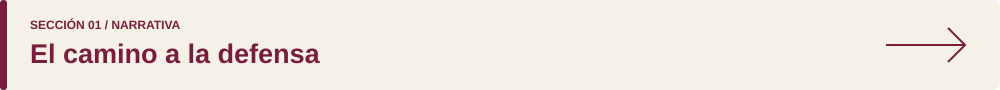
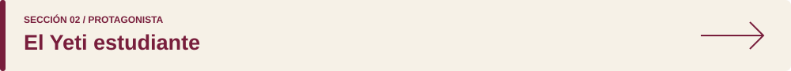
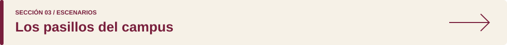
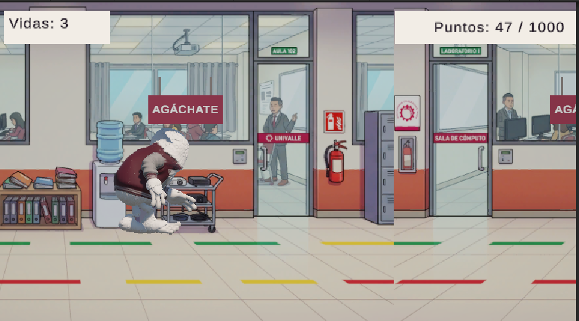
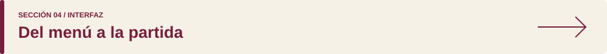
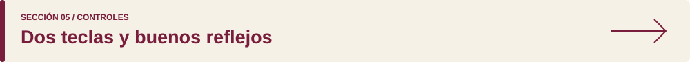
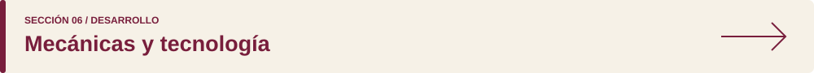
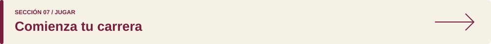
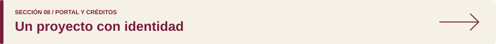

<h1>Corre Yeti Corre</h1>

<strong>ENDLESS RUNNER UNIVERSITARIO</strong>

Una defensa está por empezar. Recorre el campus, supera los obstáculos y llega a tiempo.

 &nbsp; 

 ·  · 

## Explora el campus

   

   

 ·  ·  ·  ·  ·  ·  · 

---

## 01 / Narrativa

El protagonista llega al campus y descubre que quedan pocos minutos para su defensa de Game Development. Lo que parecía un día tranquilo se convierte en una carrera por los pasillos de la universidad.

<table>
<tr><th align="left" width="50%">ACTO I / CONTRA EL RELOJ</th><th align="left" width="50%">ACTO II / CAOS EN EL CAMPUS</th></tr>
<tr><td valign="top">El tiempo apremia. El Yeti comienza a correr y encuentra libros y mochilas que interrumpen su recorrido.</td><td valign="top">La velocidad aumenta. Saltar a tiempo y agacharse bajo los carteles se vuelve esencial para continuar.</td></tr>
</table>

> **La misión:** conservar tus vidas mientras sumas puntos y avanzas hacia la defensa.

 ·  · 

---

## 02 / Protagonista

El pelaje blanco, la chaqueta guinda y gris y las proporciones de estilo cartoon le dan al protagonista una identidad reconocible dentro del campus.

| Componente | Diseño y función |
| :--- | :--- |
| **Personaje** | Un Yeti estudiante que debe llegar a su defensa |
| **Estética** | Modelo 3D de estilo cartoon |
| **Colores** | Pelaje blanco y chaqueta guinda y gris |
| **Correr** | Mantiene el desplazamiento automático |
| **Saltar** | Permite superar obstáculos bajos |
| **Agacharse** | Reduce el área de colisión para pasar bajo carteles |
| **Derrota** | Muestra la caída al perder todas las vidas |

 ·  ·  · 

---

## 03 / Escenarios

Los pasillos, las aulas y la señalética universitaria forman parte de la ambientación. Los objetos cotidianos del campus se convierten en obstáculos que exigen reaccionar a tiempo.

| Elemento | Papel en el recorrido |
| :--- | :--- |
| **Pasillos y aulas** | Dan contexto al escenario universitario |
| **Libros y mochilas** | Obstáculos que se superan saltando |
| **Carteles** | Obstáculos elevados que requieren agacharse |
| **Desplazamiento del fondo** | Acompaña la sensación de carrera |

 ·  ·  · 

---

## 04 / Interfaz

<table>
<tr><th width="50%">PORTADA DEL JUEGO</th><th width="50%">MENÚ INICIAL</th></tr>
<tr><td valign="top"></td><td valign="top"></td></tr>
<tr><td>Presenta al protagonista y la temática universitaria.</td><td>Permite comenzar una partida y controlar el sonido.</td></tr>
</table>

| Pantalla o indicador | Información para el jugador |
| :--- | :--- |
| **Menú inicial** | Acceso a la partida y al sonido |
| **Vidas** | Intentos disponibles antes de terminar la partida |
| **Puntaje y tiempo** | Progreso durante el recorrido |
| **Victoria o derrota** | Resultado de la partida y opción de volver a jugar |

 ·  ·  · 

---

## 05 / Controles

El personaje corre automáticamente. Tú decides cuándo saltar y cuándo agacharte.

| Entrada | Acción | Uso |
| :---: | :--- | :--- |
| <kbd>↑</kbd> | **Saltar** | Superar libros y mochilas |
| <kbd>↓</kbd> | **Agacharse** | Pasar bajo carteles suspendidos |
| **Clic** | **Interactuar** | Botones de inicio, sonido y nuevo intento |

**Haz clic dentro del juego antes de utilizar las flechas.**

### Reglas del recorrido

- Los impactos con obstáculos restan vidas.
- El puntaje aumenta mientras sobrevives.
- Los obstáculos aparecen de forma aleatoria.
- La dificultad aumenta durante el recorrido.
- Al finalizar, puedes iniciar una nueva partida.

 ·  ·  · 

---

## 06 / Desarrollo

| Tecnología | Uso dentro del proyecto |
| :--- | :--- |
| **Unity** | Escenas, físicas, interfaz y compilación del videojuego |
| **C#** | Movimiento, obstáculos, vidas, puntaje y sonido |
| **Mixamo** | Animaciones del personaje |
| **HTML y CSS** | Presentación y diseño adaptable del portal |
| **JavaScript** | Navegación e interacciones del portal |
| **GitHub Pages** | Publicación del portal y ejecución del juego en el navegador |

<strong>Ver la organización funcional del videojuego</strong>

| Área | Responsabilidad |
| :--- | :--- |
| **Jugador** | Ejecutar salto y agachado y coordinar animaciones |
| **Obstáculos** | Generar elementos y retirar los que quedan atrás |
| **Partida** | Controlar el progreso, el puntaje y el resultado |
| **Vidas** | Registrar impactos y determinar la derrota |
| **Interfaz** | Mostrar información y gestionar los botones |
| **Audio** | Reproducir música y efectos de acciones y resultados |

<strong>Ver las carpetas del portal</strong>

| Ruta | Contenido |
| :--- | :--- |
| `index.html` | Página principal del portal |
| `style.css` | Estilos y adaptación a diferentes pantallas |
| `script.js` | Interacciones del portal |
| `assets/images/` | Capturas, portada y personaje |
| `assets/readme/` | Cabecera, botones y navegación de esta presentación |
| `juego/index.html` | Página de ejecución del juego |
| `juego/Build/` | Compilación web de Unity |
| `juego/TemplateData/` | Recursos del reproductor |
| `README.md` | Documentación del proyecto |

 ·  ·  · 

---

## 07 / Jugar

1. Abre el .
2. Espera a que termine de cargar el menú inicial.
3. Selecciona **Jugar** en el menú inicial.
4. Haz clic dentro de la partida para activar el teclado.
5. Utiliza <kbd>↑</kbd> para saltar y <kbd>↓</kbd> para agacharte.

<strong>Requisitos y ayuda rápida</strong>

- Utiliza una computadora con teclado y un navegador compatible con WebGL.
- Necesitas conexión a internet para cargar la partida.
- Puedes ampliar la vista con el botón de pantalla completa del reproductor.
- Si las flechas no responden, haz clic dentro del juego.
- Si no escuchas audio, revisa el botón de sonido del menú y el volumen de la pestaña.
- El portal se adapta a pantallas pequeñas; esta versión del juego utiliza teclado.

 ·  ·  · 

---

## 08 / Portal y créditos

El portal reúne la presentación del juego, la historia, el protagonista, las mecánicas y el acceso a la partida. Mantiene la identidad guinda, crema y dorada del proyecto.

### Créditos

| Participación | Integrantes |
| :--- | :--- |
| **Videojuego** | Melani Quintela Aguilar y José Martin Leaño Mercado |
| **Portal web** |  |
| **Asignatura** | Game Development |

Proyecto académico desarrollado en Unity y presentado mediante un portal web.

 ·  · 

---

<strong>EL CAMPUS TE ESPERA. LA DEFENSA TAMBIÉN.</strong>

 ·  · 

