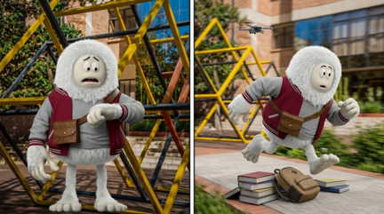
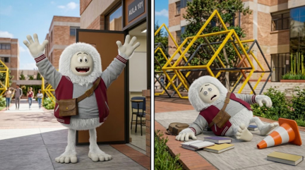
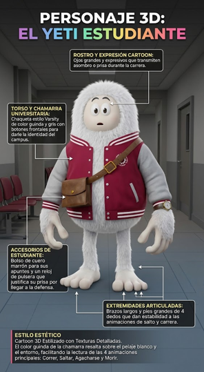

<div align="center">

  <!-- CABECERA VECTORIAL PRINCIPAL -->
  

  <br/>

  <!-- BARRA DE ETIQUETAS CON FONDO SÓLIDO (100% COMPATIBLE CON GITHUB) -->
  <p>
    
    
    
    
  </p>

  <!-- TARJETA PRINCIPAL CON CABECERA Y FONDO DIFERENCIADO -->
  <table>
    <thead>
      <tr>
        <th align="center">
          <br/>
          $\Large\color{#7A1C2E}\textbf{CORRE YETI CORRE — ENDLESS RUNNER UNIVERSITARIO}$
          <br/><br/>
        </th>
      </tr>
    </thead>
    <tbody>
      <tr>
        <td align="center">
          <br/>
          Un videojuego de carrera infinita donde cada segundo cuenta. Atraviesa los pasillos del campus, esquiva el mobiliario universitario y supera todos los obstáculos antes de que se cierren las puertas del aula de defensa.
          <br/><br/>
          <!-- BOTONES DE ACCIÓN PRINCIPALES -->
          <a href="#jugabilidad-e-interfaz">
            
          </a>
          &nbsp;&nbsp;&nbsp;&nbsp;
          <a href="#escenarios-del-campus">
            
          </a>
          <br/><br/>
        </td>
      </tr>
    </tbody>
  </table>

  <!-- MENÚ DE NAVEGACIÓN CON BOTONES DE COLOR -->
  <p>
    <a href="#narrativa-visual"></a>
    <a href="#ficha-del-protagonista"></a>
    <a href="#escenarios-del-campus"></a>
    <a href="#jugabilidad-e-interfaz"></a>
    <a href="#controles-y-mecanicas"></a>
    <a href="#arquitectura-y-metricas"></a>
  </p>

</div>

<br/>

<!-- SEPARADOR DE SECCIÓN 01 CON FONDO SÓLIDO -->
<div align="center" id="narrativa-visual">
  <table>
    <thead>
      <tr>
        <th width="1000" align="center">
          $\normalsize\color{#D4AF37}\textbf{SECCION 01}$ &nbsp; $\Large\color{#7A1C2E}\textbf{NARRATIVA VISUAL: EL CAMINO A LA DEFENSA}$
        </th>
      </tr>
    </thead>
    <tbody>
      <tr>
        <td align="center">
          <i>El reloj corre en contra y el campus está lleno de imprevistos que pondrán a prueba tus reflejos.</i>
        </td>
      </tr>
    </tbody>
  </table>
</div>

<table>
  <thead>
    <tr>
      <th width="50%" align="center">
        
      </th>
      <th width="50%" align="center">
        
      </th>
    </tr>
  </thead>
  <tbody>
    <tr>
      <td width="50%" align="center" valign="top">
        <br/>
        
        <br/><br/>
        <pre align="center">ESTADO: RETRASO CRITICO EN LA ENTRADA</pre>
        <p align="justify">
          El protagonista revisa su reloj en la entrada del campus y descubre que quedan pocos minutos para el inicio de la evaluación. Comienza una carrera a máxima velocidad saltando pilas de libros y mochilas olvidadas en el patio.
        </p>
      </td>
      <td width="50%" align="center" valign="top">
        <br/>
        
        <br/><br/>
        <pre align="center">META: LLEGAR AL AULA 101 ANTES DEL CIERRE</pre>
        <p align="justify">
          Un tropiezo con conos de señalización o apuntes desparramados puede costar la llegada al Aula 101. El objetivo es mantener el ritmo, reaccionar a tiempo y cruzar la puerta antes del cierre.
        </p>
      </td>
    </tr>
  </tbody>
</table>

<br/>

<!-- SEPARADOR DE SECCIÓN 02 CON FONDO SÓLIDO -->
<div align="center" id="ficha-del-protagonista">
  <table>
    <thead>
      <tr>
        <th width="1000" align="center">
          $\normalsize\color{#D4AF37}\textbf{SECCION 02}$ &nbsp; $\Large\color{#7A1C2E}\textbf{FICHA TECNICA: EL YETI ESTUDIANTE}$
        </th>
      </tr>
    </thead>
  </table>
</div>

<table>
  <thead>
    <tr>
      <th width="45%" align="center">INFOGRAFIA DE DISEÑO 3D</th>
      <th width="55%" align="center">PERFIL Y ATRIBUTOS DEL PERSONAJE</th>
    </tr>
  </thead>
  <tbody>
    <tr>
      <td width="45%" align="center" valign="middle">
        
      </td>
      <td width="55%" valign="top">
        <div align="center">
          <br/>
          
          <br/><br/>
          
        </div>
        <br/>
        <table>
          <thead>
            <tr>
              <th align="left">COMPONENTE</th>
              <th align="left">ESPECIFICACION VISUAL Y FUNCIONAL</th>
            </tr>
          </thead>
          <tbody>
            <tr>
              <td><b>ROSTRO</b></td>
              <td>Ojos grandes de estilo cartoon que transmiten asombro y urgencia durante toda la partida.</td>
            </tr>
            <tr>
              <td><b>VESTIMENTA</b></td>
              <td>Chamarra universitaria estilo Varsity en tonos guinda y gris con botones frontales sobre pelaje blanco.</td>
            </tr>
            <tr>
              <td><b>ACCESORIOS</b></td>
              <td>Bolso cruzado de cuero marrón para apuntes y reloj de pulsera que marca el límite de tiempo.</td>
            </tr>
            <tr>
              <td><b>ANIMACIONES</b></td>
              <td>Extremidades articuladas diseñadas para las 4 acciones clave: <b>Correr, Saltar, Agacharse y Colisionar</b>.</td>
            </tr>
          </tbody>
        </table>
      </td>
    </tr>
  </tbody>
</table>

<br/>

<!-- SEPARADOR DE SECCIÓN 03 CON FONDO SÓLIDO -->
<div align="center" id="escenarios-del-campus">
  <table>
    <thead>
      <tr>
        <th width="1000" align="center">
          $\normalsize\color{#D4AF37}\textbf{SECCION 03}$ &nbsp; $\Large\color{#7A1C2E}\textbf{ESCENARIOS Y PASILLOS UNIVERSITARIOS}$
        </th>
      </tr>
    </thead>
    <tbody>
      <tr>
        <td align="center">
          <i>Ambientes diseñados con identidad institucional, iluminación interior detallada y obstáculos integrados en el recorrido.</i>
        </td>
      </tr>
    </tbody>
  </table>
</div>

<!-- TARJETA PANORÁMICA PRINCIPAL -->
<table>
  <thead>
    <tr>
      <th align="center">
        
      </th>
    </tr>
  </thead>
  <tbody>
    <tr>
      <td align="center">
        <br/>
        
        <br/><br/>
        <pre align="center">CORREDOR PRINCIPAL — SEÑALIZACION VIAL EN PISO, BEBEDEROS Y CARRITOS DE PROYECTORES</pre>
        <p>Vista general del corredor principal con señalización en el piso, dispensadores de agua, estantes de libros y equipos audiovisuales.</p>
      </td>
    </tr>
  </tbody>
</table>

<!-- GRILLA DE TRES TARJETAS CON CABECERA Y FONDO -->
<table>
  <thead>
    <tr>
      <th width="33%" align="center">
        
      </th>
      <th width="33%" align="center">
        
      </th>
      <th width="33%" align="center">
        
      </th>
    </tr>
  </thead>
  <tbody>
    <tr>
      <td width="33%" align="center" valign="top">
        <br/>
        
        <br/><br/>
        <pre>OBSTACULOS: MOCHILAS Y BASUREROS</pre>
        <p align="center">Tramo con alta densidad de mochilas, basureros y mobiliario frente al Laboratorio 1 y Aula 102.</p>
      </td>
      <td width="33%" align="center" valign="top">
        <br/>
        
        <br/><br/>
        <pre>OBSTACULOS: MAQUINAS VENDING</pre>
        <p align="center">Sección intermedia equipada con máquinas expendedoras de snacks y bebidas junto a las salas de estudio.</p>
      </td>
      <td width="33%" align="center" valign="top">
        <br/>
        
        <br/><br/>
        <pre>MECANICA: DESLIZAMIENTO Y HUD</pre>
        <p align="center">Demostración en partida con contador de vidas, puntaje activo y alertas de acción para esquivar obstáculos.</p>
      </td>
    </tr>
  </tbody>
</table>

<br/>

<!-- SEPARADOR DE SECCIÓN 04 CON FONDO SÓLIDO -->
<div align="center" id="jugabilidad-e-interfaz">
  <table>
    <thead>
      <tr>
        <th width="1000" align="center">
          $\normalsize\color{#D4AF37}\textbf{SECCION 04}$ &nbsp; $\Large\color{#7A1C2E}\textbf{INTERFAZ GRAFICA: PORTADA Y MENU}$
        </th>
      </tr>
    </thead>
  </table>
</div>

<table>
  <thead>
    <tr>
      <th width="50%" align="center">
        
      </th>
      <th width="50%" align="center">
        
      </th>
    </tr>
  </thead>
  <tbody>
    <tr>
      <td width="50%" align="center" valign="top">
        <br/>
        
        <br/><br/>
        <pre>PANTALLA DE PRESENTACION OFICIAL</pre>
      </td>
      <td width="50%" align="center" valign="top">
        <br/>
        
        <br/><br/>
        <pre>ACCESO A PARTIDA Y CONFIGURACION</pre>
      </td>
    </tr>
  </tbody>
</table>

<br/>

<!-- SEPARADOR DE SECCIÓN 05 CON FONDO SÓLIDO -->
<div align="center" id="controles-y-mecanicas">
  <table>
    <thead>
      <tr>
        <th width="1000" align="center">
          $\normalsize\color{#D4AF37}\textbf{SECCION 05}$ &nbsp; $\Large\color{#7A1C2E}\textbf{ESQUEMA DE CONTROLES Y MECANICAS}$
        </th>
      </tr>
    </thead>
  </table>
</div>

<div align="center">
  <table>
    <thead>
      <tr>
        <th align="center">ACCION</th>
        <th align="center">TECLA PRINCIPAL</th>
        <th align="center">TECLA ALTERNATIVA</th>
        <th align="left">FUNCION DENTRO DE LA PARTIDA</th>
      </tr>
    </thead>
    <tbody>
      <tr>
        <td align="center"></td>
        <td align="center"><kbd>Espacio</kbd></td>
        <td align="center"><kbd>W</kbd> / <kbd>Flecha Arriba</kbd></td>
        <td>Permite superar mochilas, botes de basura, libros apilados y conos en el suelo.</td>
      </tr>
      <tr>
        <td align="center"></td>
        <td align="center"><kbd>S</kbd></td>
        <td align="center"><kbd>Flecha Abajo</kbd></td>
        <td>Reduce la caja de colisión del personaje para pasar bajo carritos y obstáculos altos.</td>
      </tr>
      <tr>
        <td align="center"></td>
        <td align="center"><kbd>A</kbd> / <kbd>D</kbd></td>
        <td align="center"><kbd>Flecha Izq.</kbd> / <kbd>Der.</kbd></td>
        <td>Desplaza lateralmente al personaje entre los carriles del pasillo universitario.</td>
      </tr>
      <tr>
        <td align="center"></td>
        <td align="center"><kbd>Esc</kbd></td>
        <td align="center"><kbd>P</kbd></td>
        <td>Detiene temporalmente la partida y muestra las opciones de reinicio o salida.</td>
      </tr>
    </tbody>
  </table>
</div>

<br/>

<!-- SEPARADOR DE SECCIÓN 06 CON FONDO SÓLIDO -->
<div align="center" id="arquitectura-y-metricas">
  <table>
    <thead>
      <tr>
        <th width="1000" align="center">
          $\normalsize\color{#D4AF37}\textbf{SECCION 06}$ &nbsp; $\Large\color{#7A1C2E}\textbf{METRICAS Y ESTRUCTURA DEL PROYECTO}$
        </th>
      </tr>
    </thead>
  </table>
  
</div>

<br/>

<details>
  <summary><b>ESTRUCTURA DE ARCHIVOS MULTIMEDIA DEL REPOSITORIO (CLIC PARA DESPLEGAR)</b></summary>
  <br/>

```text
├── README.md
└── assets/
    ├── images/
    │   ├── Fondo_02.jpg               # Escenario de pasillo con laboratorios y mochilas
    │   ├── Fondo_03.jpg               # Escenario de pasillo con máquinas expendedoras
    │   ├── Fondo_Pasillo.jpg          # Escenario base del corredor universitario
    │   ├── escenario-universidad.png  # Captura de partida en curso con interfaz HUD
    │   ├── menu-inicial.png           # Interfaz gráfica del menú principal
    │   ├── personaje-yeti.png         # Render limpio del protagonista
    │   ├── personaje.png              # Infografía técnica 3D del Yeti Estudiante
    │   ├── portada-juego.png          # Arte promocional principal
    │   ├── story1.png                 # Viñeta narrativa Acto I
    │   └── story2.png                 # Viñeta narrativa Acto II
    └── readme/
        ├── cabecera.svg               # Banner vectorial superior
        ├── boton-jugar.svg            # Botón interactivo de acceso al juego
        ├── boton-portal.svg           # Botón interactivo del portal web
        └── metricas.svg               # Panel vectorial de estadísticas
