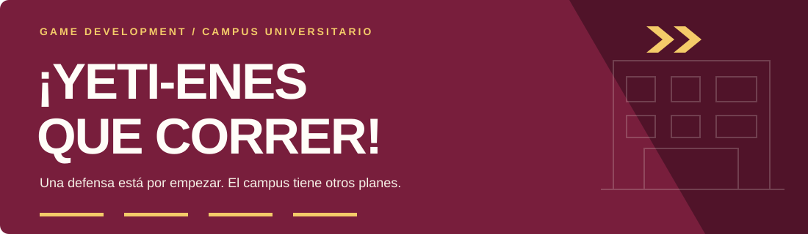
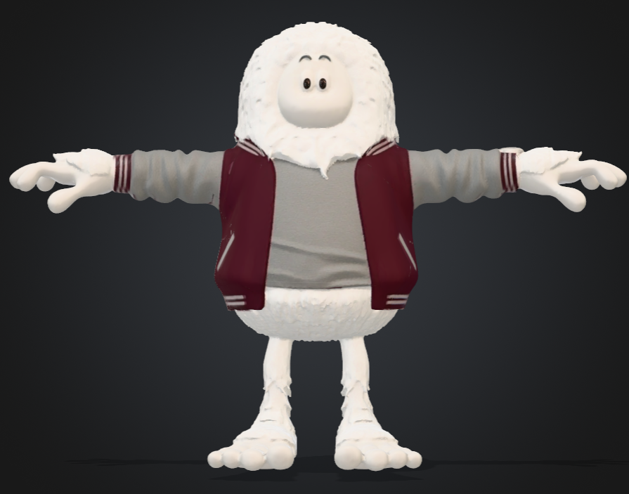
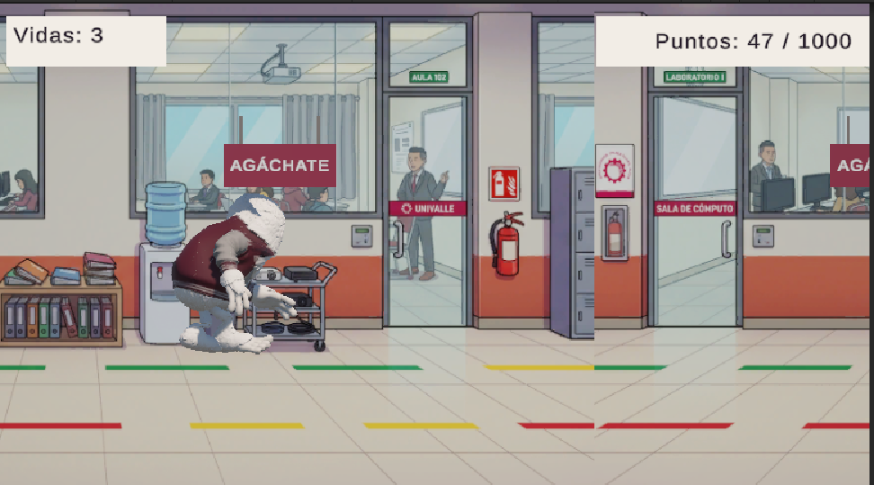
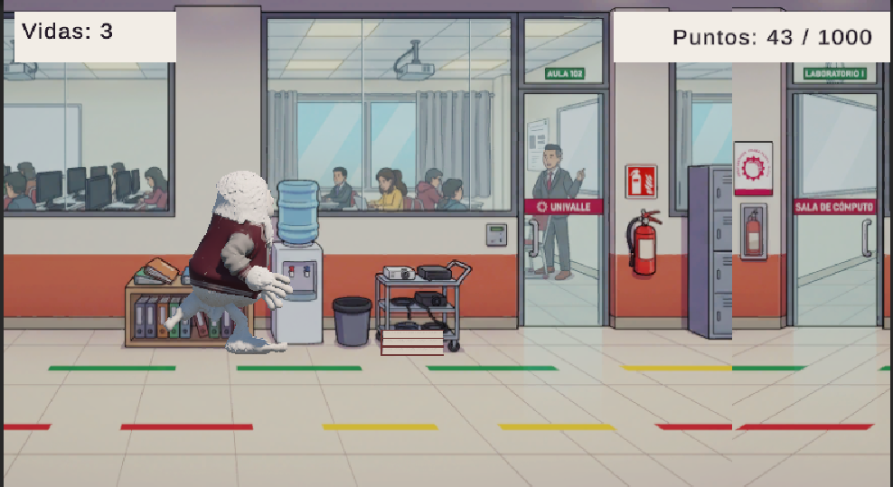
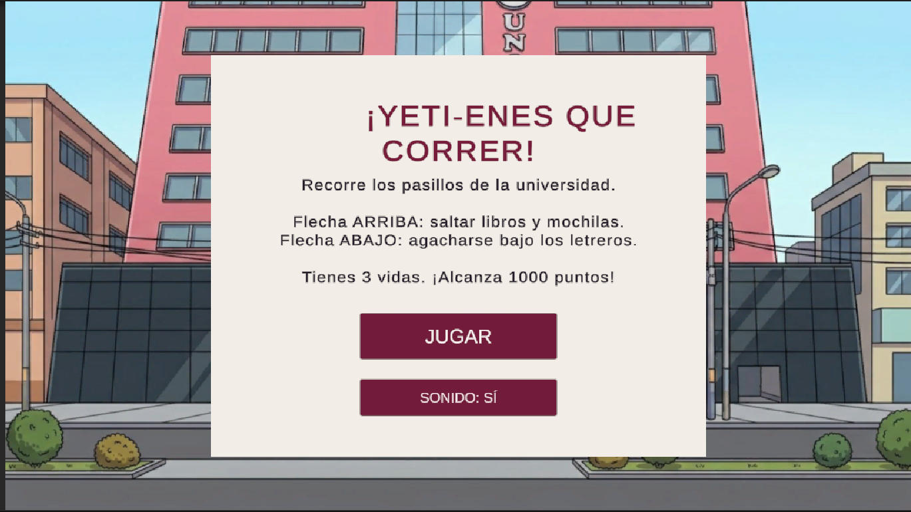

 

# Corre Yeti Corre

**ENDLESS RUNNER UNIVERSITARIO**

*Una defensa está por empezar. Recorre el campus, supera los obstáculos y llega a tiempo.*

<code>VIDAS 3/3</code> &nbsp;·&nbsp; <code>PUNTAJE 0000</code> &nbsp;·&nbsp; <code>TIEMPO 00:30</code> &nbsp;·&nbsp; <code>NIVEL CAMPUS</code>

&nbsp;

 

## Historia

El protagonista llega al campus y descubre que quedan pocos minutos para su defensa de Game Development. Lo que parecía un día tranquilo se convierte en una carrera por los pasillos de la universidad.

<table>
<tr>
<th align="left" width="50%">ACTO I &nbsp;/&nbsp; CONTRA EL RELOJ</th>
<th align="left" width="50%">ACTO II &nbsp;/&nbsp; CAOS EN EL CAMPUS</th>
</tr>
<tr>
<td valign="top">El Yeti comienza a correr y encuentra libros y mochilas que interrumpen su recorrido.</td>
<td valign="top">La velocidad aumenta. Saltar a tiempo y agacharse bajo los carteles se vuelve esencial para continuar.</td>
</tr>
</table>

> [!IMPORTANT]
> **La misión:** conservar tus vidas mientras sumas puntos y avanzas hacia la defensa.

## Protagonista

 

Un Yeti estudiante de pelaje blanco y chaqueta guinda y gris. Sus proporciones cartoon le dan una identidad reconocible dentro del campus.

| Acción | Descripción |
| :--- | :--- |
| **Correr** | Desplazamiento automático durante todo el recorrido |
| **Saltar** | Permite superar obstáculos bajos |
| **Agacharse** | Reduce el área de colisión para pasar bajo carteles |
| **Derrota** | Se muestra la caída al perder todas las vidas |

## Escenarios

 

Los pasillos, las aulas y la señalética universitaria forman parte de la ambientación. Los objetos cotidianos del campus se convierten en obstáculos que exigen reaccionar a tiempo.

| Elemento | Papel en el recorrido |
| :--- | :--- |
| **Libros y mochilas** | Obstáculos que se superan saltando |
| **Carteles** | Obstáculos elevados que requieren agacharse |
| **Fondo en movimiento** | Refuerza la sensación de carrera |

## Interfaz

<table>
<tr>
<th width="50%">PORTADA DEL JUEGO</th>
<th width="50%">MENÚ INICIAL</th>
</tr>
<tr>
<td></td>
<td></td>
</tr>
<tr>
<td>Presenta al protagonista y la temática universitaria.</td>
<td>Permite comenzar una partida y controlar el sonido.</td>
</tr>
</table>

Durante la partida se muestran las **vidas**, el **puntaje** y el **tiempo**. Al terminar aparece el resultado (victoria o derrota) con la opción de volver a jugar.

## Controles

El personaje corre automáticamente. Tú decides cuándo saltar y cuándo agacharte.

| Tecla | Acción | Uso |
| :---: | :--- | :--- |
| <kbd>↑</kbd> | **Saltar** | Superar libros y mochilas |
| <kbd>↓</kbd> | **Agacharse** | Pasar bajo carteles suspendidos |
| **Clic** | **Interactuar** | Botones de inicio, sonido y nuevo intento |

> [!TIP]
> Haz clic dentro del juego antes de usar las flechas para activar el teclado.

**Reglas del recorrido**

- Los impactos con obstáculos restan vidas.
- El puntaje aumenta mientras sobrevives.
- Los obstáculos aparecen de forma aleatoria.
- La dificultad aumenta durante el recorrido.

## Desarrollo

| Tecnología | Uso dentro del proyecto |
| :--- | :--- |
| **Unity** | Escenas, físicas, interfaz y compilación del videojuego |
| **C#** | Movimiento, obstáculos, vidas, puntaje y sonido |
| **Mixamo** | Animaciones del personaje |
| **HTML y CSS** | Presentación y diseño adaptable del portal |
| **JavaScript** | Navegación e interacciones del portal |
| **GitHub Pages** | Publicación del portal y ejecución del juego en el navegador |

<strong>Organización funcional del videojuego</strong>

 

| Área | Responsabilidad |
| :--- | :--- |
| **Jugador** | Ejecutar salto y agachado, y coordinar animaciones |
| **Obstáculos** | Generar elementos y retirar los que quedan atrás |
| **Partida** | Controlar el progreso, el puntaje y el resultado |
| **Vidas** | Registrar impactos y determinar la derrota |
| **Interfaz** | Mostrar información y gestionar los botones |
| **Audio** | Reproducir música y efectos |

<strong>Estructura del repositorio</strong>

 

| Ruta | Contenido |
| :--- | :--- |
| `index.html` | Página principal del portal |
| `style.css` | Estilos y adaptación a diferentes pantallas |
| `script.js` | Interacciones del portal |
| `assets/images/` | Capturas, portada y personaje |
| `assets/readme/` | Cabecera, botones y divisores de este README |
| `juego/index.html` | Página de ejecución del juego |
| `juego/Build/` | Compilación web de Unity |
| `juego/TemplateData/` | Recursos del reproductor |

## Cómo jugar

1. Abre el [juego en GitHub Pages](https://katfipol.github.io/yeti-portal/juego/).
2. Espera a que cargue el menú inicial.
3. Selecciona **Jugar**.
4. Haz clic dentro de la partida para activar el teclado.
5. Usa <kbd>↑</kbd> para saltar y <kbd>↓</kbd> para agacharte.

<strong>Requisitos y ayuda rápida</strong>

 

- Computadora con teclado y un navegador compatible con WebGL.
- Conexión a internet para cargar la partida.
- Botón de pantalla completa disponible en el reproductor.
- Si las flechas no responden, haz clic dentro del juego.
- Si no escuchas audio, revisa el botón de sonido del menú y el volumen de la pestaña.
- El portal se adapta a pantallas pequeñas, pero el juego requiere teclado.

## Créditos

| Participación | Integrantes |
| :--- | :--- |
| **Videojuego** | Melani Quintela Aguilar y José Martin Leaño Mercado |
| **Portal web** |  |
| **Asignatura** | Game Development |

Proyecto académico desarrollado en Unity y presentado mediante un portal web.

 

**EL CAMPUS TE ESPERA. LA DEFENSA TAMBIÉN.**

